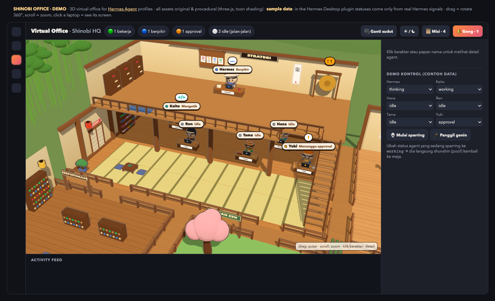
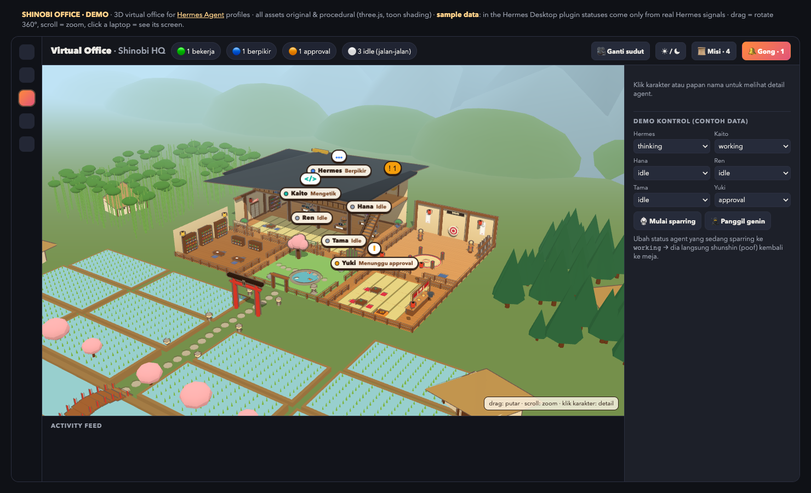
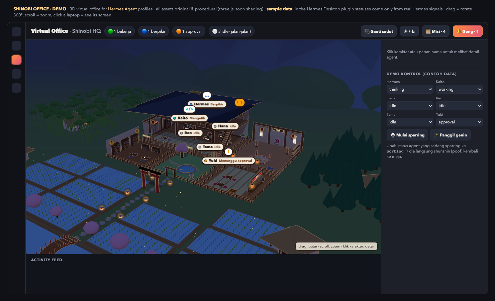
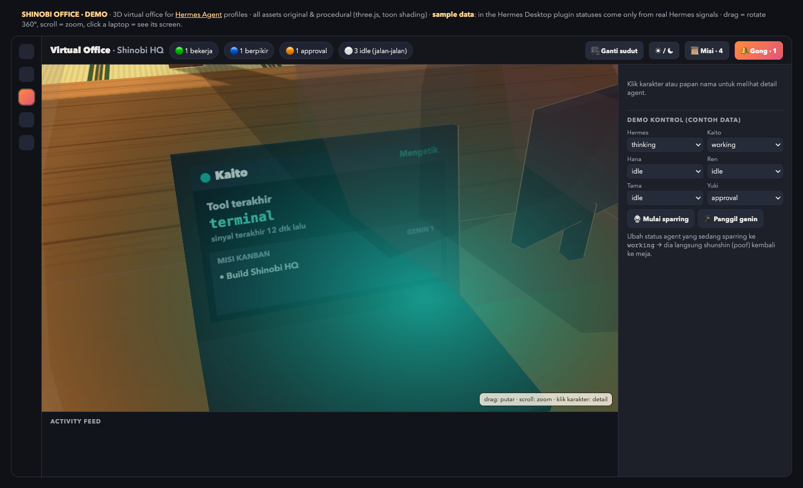
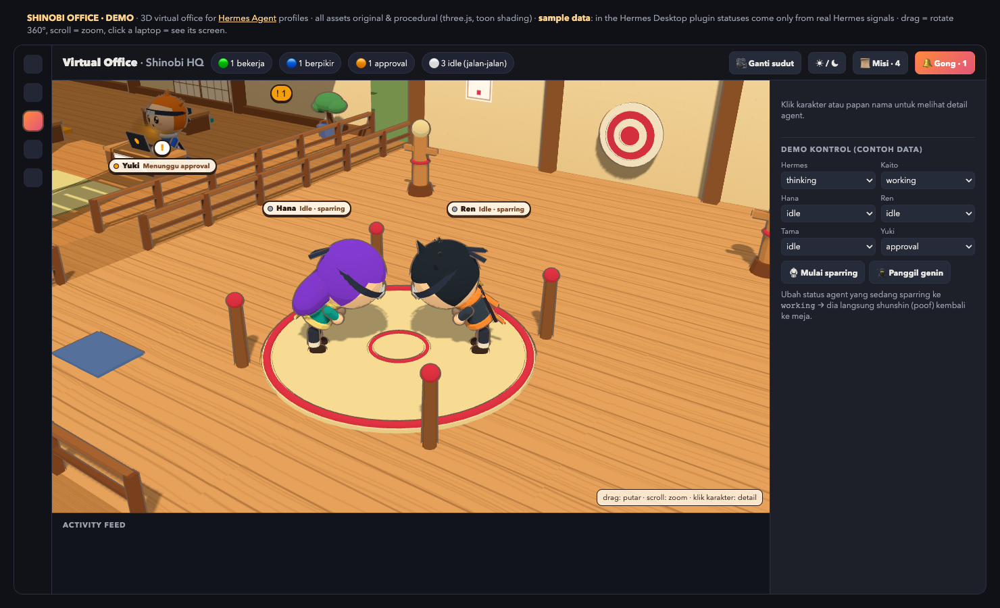

# Shinobi Office 🥷🏯

**A 3D ninja-village virtual office for your [Hermes Agent](https://github.com/NousResearch/hermes-agent) profiles.**
Every Hermes profile becomes a chibi ninja with its own desk and laptop. When an agent works, it sits at its
desk and types. When it's idle, it walks the village, drinks tea, reads scrolls, naps (if it's a cat), chats
with teammates or spars in the dojo. When real work arrives, it *shunshin*s (body-flickers) back to its desk
in under 0.4 seconds.

- **Hermes Desktop plugin.** It adds a **Virtual Office** page (`/office`) to Hermes Desktop.
- **Self-hostable web demo.** A static page with sample data that you can host anywhere. See the roadmap
  below for a live self-hosted mode.



| Village (day) | Village (night) |
|---|---|
|  |  |
| **Laptop screens (status only)** | **Sparring in the dojo** |
|  |  |

## Features

- **Real signals only.** Statuses come from live Hermes events, `session.active_list`, `profiles.list` and the
  Kanban board. If a status can't be determined, the agent shows `unknown`. An agent that goes quiet after
  working shows `stale`. Idle activities are purely visual and never pretend to be work.
- **Two-storey HQ.** Floor 1 is the team room. Floor 2 is the Kage's strategy room, with the Mission Board
  (your Kanban), the approval gong and a balcony. Agents really walk the stairs.
- **The village.** It has a dojo, a scroll library, a zen garden with koi, and a tea & ramen house. Beyond the
  gate are terraced rice paddies, a torii, a river with a bridge, farmhouses, bamboo, and mountains. A
  day/night cycle follows your time zone, with lanterns and fireflies at night.
- **360° camera.** Walls in front of the camera fade automatically. Click any laptop (or press **Lihat layar**)
  to fly over the agent's shoulder and read its screen. Screens show status, last tool *name*, signal age,
  Kanban mission titles and the subagent count. They never show message text.
- **Every new profile joins automatically.** It gets a deterministic look and archetype (coder, artist,
  herald, editor, messenger, scholar or ninja cat 🐱). You can customize everything in a config file.
- **Subagents appear as genin.** They walk from the Academy door to their parent's desk and poof when done.
- **Lightweight.** The office uses no external assets. It runs at 30 fps (8 fps when the window is in the
  background) and pauses when hidden. A quality setting (Auto/High/Eco) drops to Eco automatically on slower
  GPUs, and reduced-motion is supported.
- **Read-only and safe.** The only actions are navigation: *Buka Chat*, *Chat Baru* and *Buka di Kanban*. The
  office never steers, interrupts or approves anything. See [docs/PRIVACY.md](docs/PRIVACY.md).

> The UI language is currently **Bahasa Indonesia**. i18n is on the roadmap, and PRs are welcome.

## Install as a Hermes Desktop plugin

You need Node.js 22 or newer and a recent Hermes Desktop with desktop-plugin support. The bundle is about
730 KB, so your Desktop version must support plugin bundles larger than 512 KiB.

```bash
git clone https://github.com/bryanperdana/shinobi-office.git
cd shinobi-office
npm ci
npm run install:plugin        # builds dist/plugin.js → ~/.hermes/desktop-plugins/shinobi-office/plugin.js
```

Then in Hermes Desktop, open the command palette (⌘K / Ctrl+K), choose **Reload desktop plugins**, and open
**Virtual Office** from the sidebar.

- **Custom plugin folder:** `SHINOBI_PLUGIN_DIR=/path/to/desktop-plugins bash scripts/install.sh`
- **Uninstall:** `bash scripts/install.sh --remove`. This moves the plugin into a `.backups` folder.
- **Remote Desktop clients:** plugins load from the *client* machine's disk. If you use a Desktop that
  connects to a remote Hermes gateway, install the plugin on the client. The data still comes from the
  remote gateway.

## Self-hosted web demo

```bash
npm ci
npm run build:web             # → web/app.js
npm run serve:web             # http://127.0.0.1:8080/
```

`web/` is a fully static site made of `index.html` and `app.js`, so you can deploy it to any static host
(GitHub Pages, Netlify, Vercel, Nginx…). It runs on **sample data** and includes demo controls for changing
statuses, sparring and spawning genin. To run it against a live Hermes instance, see
[docs/SELF_HOSTING.md](docs/SELF_HOSTING.md).

## Customize

Copy `src/config.js` to `src/config.local.js`, which git ignores, and edit it there. `npm run build` picks it
up automatically.

```js
import { CONFIG as BASE } from './config.js'
export const CONFIG = {
  ...BASE,
  ownerName: 'Sensei',                 // who the team serves (idle chatter, "waiting for …" on laptops)
  timeZone: 'Europe/Berlin',
  presets: {
    ...BASE.presets,
    'my-coder': { name: 'Kaito', role: 'Dev Lab', style: 'spiky', props: ['dual'], voice: 'coder', hair: '#2A2438', jacket: '#E2557A', trim: '#2A2438' },
    'my-cat':   { name: 'Tama', role: 'Treasury', species: 'cat', style: 'cat', fur: '#F2A65A', stripe: '#8A4B1F', muzzle: '#FFF1DC', props: ['abacus'], voice: 'cat' },
  },
  order: ['default', 'my-coder', 'my-cat'],
}
```

All options are documented in [docs/CONFIGURATION.md](docs/CONFIGURATION.md).

## Development

```bash
npm test                 # unit tests: simulation, navigation, live status model, missions, chat bank
npm run build            # dist/plugin.js (uses src/config.local.js if present)
npm run check            # bundle may only import @hermes/plugin-sdk / react / react/jsx-runtime
npm run qa:plugin        # Playwright: real bundle against a mock SDK (needs: npx playwright install chromium)
npm run qa:3d            # Playwright: web demo rendering checks
npm run screenshots      # regenerate docs/screenshots
```

The architecture is described in [docs/ARCHITECTURE.md](docs/ARCHITECTURE.md). In short:

- The simulation (`src/scene3d/brain.js`, `grid.js`, `world.js`) and the live status model
  (`src/live/model.js`) are pure JS with no three.js or SDK dependency, so they are unit-tested in Node.
- The renderer only reads their state.
- The only Hermes-specific glue is `src/plugin/`.

## Roadmap

- Live self-hosted mode: a small read-only bridge to a Hermes gateway (see docs/SELF_HOSTING.md).
- i18n (English UI).
- More archetypes, rooms and seasonal village themes.

## Contributing & license

Issues and PRs are welcome; see [CONTRIBUTING.md](CONTRIBUTING.md). Licensed under the [MIT License](LICENSE).
Third-party notices are in [THIRD_PARTY_NOTICES.md](THIRD_PARTY_NOTICES.md).

Shinobi Office is a community project and is not affiliated with Nous Research. All art is original and
procedural.

---

### Bahasa Indonesia (ringkas)

Shinobi Office adalah kantor virtual 3D bergaya desa ninja untuk agent Hermes. Setiap profile menjadi ninja
dengan meja dan laptop.

- **Saat bekerja:** agent duduk di meja.
- **Saat idle:** agent jalan-jalan, ngobrol, atau sparring di dojo.
- **Saat ada kerja nyata:** agent langsung *shunshin* kembali ke meja.

Cara pakai:

- **Pasang sebagai plugin Hermes Desktop:** `npm ci && npm run install:plugin`, lalu jalankan **Reload desktop
  plugins** di Hermes Desktop.
- **Jalankan versi web (self-hosted):** `npm run build:web && npm run serve:web`.
- **Atur preset agent dan nama kamu:** di `src/config.local.js`.
